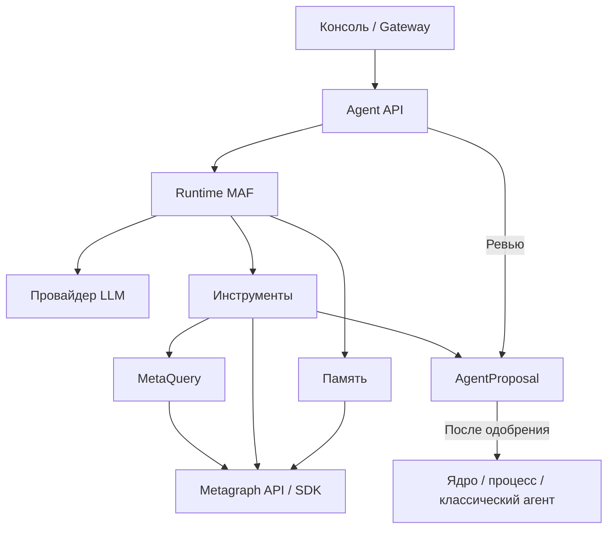

# Исполнение LLM-агентов на платформе .NET

**Техническое задание · CopiumCore · ИУ5-31Б**

Редакция 1.1 от 19 ноября 2026 года. Рабочая спецификация автономного модуля для кейс-чемпионата. Основание — «Укрупненная архитектура метаграфовой платформы (v1)», с. 2–3, 18–20.

**Результат поставки.** Пользователь запускает C#-агента из консоли, проверяет источник и подтверждает правку. Второй клиент читает сохранённый объект, автора, сессию, время и основание. CopiumCore демонстрирует весь цикл на собственном стенде. Для защиты команда также показывает, какие ожидающие решения потеряли основание после изменения метаграфа и сколько повторных запусков можно избежать.

**Команда.** Белоглазов Артём — TeamLead. Новиков Святослав, Крамарев Тимофей, Левченков Сергей, Леонов Александр — разработчики. Все участники — ИУ5-31Б.

**Статус решений.** «А» — требование архитектуры преподавателя. «П» — проектное решение CopiumCore. «С» — параметр будущего подключения (маршрут, схема данных, транспорт или возможности сервиса). Для каждого С команда задаёт рабочий локальный профиль. Реальный интерфейс подключается, когда появится его спецификация. Официальные сроки и шкалу оценки уточняет TeamLead.

**Как пользоваться.** Разделы 1–11 описывают требования, границы и исполнение. В разделах 12–16 даны демо, испытания и план команды. Раздел 17 содержит вопросы преподавателю, 18 — задания для OpenCode, 19 — источники. Конкурсная разработка CopiumCore, эксперимент и сценарий защиты описаны в разделах 20–21.



## 1. Объём работ и граница MVP

**А.** CopiumCore поставляет внутренний модуль платформы. Готовый Microsoft Agent Framework (MAF) выполняет агента, Microsoft.Extensions.AI (MEAI) унифицирует доступ к моделям. Центральное хранилище обслуживает память, контекст, результаты и обмен сведениями с процессами и классическими агентами. Основа реализации — C#, .NET 10 LTS, ASP.NET Core, модульный монолит с портами и адаптерами. Рекомендуемые технологии допускают уточнение при проектировании [A1, с. 3, 18–20].

| Объём | Результат, который принимаем |
|---|---|
| Агент и сессия | Каталог конфигураций с версиями, запуск по HTTP и из пользовательской консоли, изолированные сессии, структурированный ответ |
| Модели и инструменты | Одна реальная локальная и одна реальная внешняя модель. Типизированные вызовы Query, чтения объекта/фрагмента, связей, подготовки изменения, запуска процесса и классического агента |
| Данные | Поиск релевантного контекста, рабочая память, история, долговременные факты, происхождение каждой сохранённой записи |
| Применение изменений | Ревью предложения, подтверждение или отклонение, условная запись, защита от повторного эффекта |
| Совместимость | Версионированные схемы, адаптеры и переносимый набор проверок. Автономный Compose проверяет каждый стык. Тот же набор можно направить на будущую реализацию. |
| Общая поставка | Запускаемый модуль, Dockerfile, локальный Docker Compose, /health, журналы, модульные и интеграционные тесты с тестовым хранилищем, руководство, демоданные и работающий сценарий |

**Распределение предметной области.** Команда ядра владеет хранилищем и Metagraph API/SDK. Синтаксис и исполнение MetaQuery поставляет команда языка. Правила, RETE и нечёткий вывод исполняет среда классических агентов. Движок процессов исполняет процесс, портал предоставляет общую консоль, Python-команда — собственный SDK и адаптер памяти. CopiumCore отвечает за вызов, проверку полномочий, передачу контекста и регистрацию результата на своей стороне.

**Расширения после MVP.** По результатам измерений допустимы векторный поиск через возможности ядра, потоковая выдача прогресса или пакетное чтение. Приоритет получает изменение, у которого есть исходный замер, воспроизводимый тест и владелец. Kubernetes, распределённые транзакции и самостоятельная разработка второго оркестратора за рамками v1 [A1, с. 3, 20].

## 2. Функциональные требования и трассировка

Для автономного MVP обязательны FR-01…14. AT в разделе 14 задают наблюдаемый результат и выполняются на стенде CopiumCore. FR-15 в разделе 20 — собственная конкурсная разработка сверх архитектурного минимума. Её проверяет AT-17 (раздел 21). В отчёте по каждому стыку указывают реализацию, профиль и версию контракта.

| ID | Наблюдаемое требование | Основание | Приёмка |
|---|---|---|---|
| FR-01 | Администратор создаёт, читает, изменяет и удаляет конфигурацию. Исторический запуск доступен с исходной версией. | А, с. 18–19 + П | AT-01 |
| FR-02 | Один сценарий работает через MAF/MEAI на локальном и внешнем провайдере. Смена профиля производится конфигурацией. | А, с. 18–20 | AT-02 |
| FR-03 | Оператор запускает агента по API и из пользовательской консоли, видит статус, результат и ошибку. | А, с. 19 | AT-03 |
| FR-04 | Каждый запуск имеет agentId, userId, sessionId, taskId и самостоятельный runId. Сервер сверяет область доступа. | А, с. 19 + П | AT-04 |
| FR-05 | Агент выполняет XQuery-подобный запрос, читает объект, фрагмент и связанные элементы через типизированные инструменты. | А, с. 18–19 | AT-05 |
| FR-06 | По запросу агента можно инициировать разрешённый процесс или классического агента. Возвращается внешний ID. | А, с. 18 + П | AT-06 |
| FR-07 | Адаптер извлекает рабочий контекст и историю, сохраняет эпизоды и извлекает долговременные факты с автором, временем и источником. | А, с. 18–19 | AT-07 |
| FR-08 | Модель формирует AgentProposal. Только одобренное предложение допускает предметную запись. Отклонение сохраняется в аудите. | А, с. 19–20 | AT-08, 09 |
| FR-09 | Сервис публикует события выполнения в шину, потребитель связывает их с запуском и корректно переживает повтор. | А, с. 19 + П | AT-10 |
| FR-10 | Журнал и трасса показывают запросы к модели, инструменты, память, ошибки, длительность и доступные данные о стоимости. | А, с. 19 | AT-11 |
| FR-11 | Структурированный результат проходит проверку схемы и ссылок на прочитанные источники до выдачи потребителю. | А, с. 18 + П | AT-12 |
| FR-12 | Законченный сценарий проходит от консоли до независимого чтения результата из центрального хранилища. | А, с. 20 | AT-13 |
| FR-13 | Локальная поставка стартует в собственном Compose и допускает подключение к общему Compose, имеет /health, документацию, демонстрационные данные и автоматические тесты. | А, с. 3 | AT-14 |
| FR-14 | Отмена, дедлайн, перегрузка и восстановление после рестарта дают проверяемое конечное состояние и сохраняют аудит. | П | AT-15, 16 |

## 3. Совместимость с модулями платформы

Архитектура определяет роли модулей [A1, с. 2–3]. За публичный Agent API отвечает CopiumCore. Для исходящих вызовов команда фиксирует минимальные нужные операции и размещает преобразование в адаптере. URL, префиксы, настройки авторизации и транспорта задаются профилем. Одна автономная поставка содержит консоль, тестовый сервис метаграфа и средства проверки остальных границ.

| Граница платформы | Что реализуем | Как проверяем своими силами |
|---|---|---|
| Gateway и портал | Версионированный HTTP API, авторизация, статусы, ревью. | Тонкая консоль обращается к сервису по настраиваемому base URL. Второй клиент проходит тот же сценарий по OpenAPI. |
| Хранилище | Чтение фрагмента и версии, условная запись, поиск операции по ID, хранение памяти. | Отдельный тестовый Graph API в Compose, данные на томе. Проверить конкурирующую запись, рестарт, потерю ответа после commit. |
| MetaQuery | Параметризованный текст и проекция результата с источниками. | Локальный исполнитель поддерживает опубликованное подмножество для демо и проверяется на разных данных. Остальная грамматика возвращает явную ошибку. |
| Процессы и классические агенты | Принимать команду запуска, возвращать runId; отправлять разрешённую команду и читать её квитанцию. | Испытательный HTTP-клиент имитирует входящий запуск; тестовые получатели регистрируют исходящие команды, статусы и число эффектов. |
| Шина | Конверт события, eventId, версия, traceparent, повторы. | Локальный транспорт и отдельный тестовый потребитель принимают реальные сообщения. Проверить разрыв связи и повторную доставку. |
| Python SDK и память | Документировать scope, kind, источник, время и правила доступа. | Независимый Python-клиент со стандартным HTTP читает запись через тестовый Graph API. Проверить разрешённую и чужую область. |
| LINQ, формы, отчёты и BI | Публиковать objectId и ссылку на проверенное изменение. | Независимый клиент читает объект по ID после подтверждения. Публичные DTO свободны от типов конкретного портала, языка и BI. |

**Подключение произвольной реализации.** Зафиксировать профиль v1 и примеры успеха, отказа, конфликта, дубля и тайм-аута. Внешний адаптер переводит поля, адреса и ошибки; при совпадении формата достаточно сменить конфигурацию. Прогнать тот же набор на указанном URL. Отчёт содержит статус каждой возможности, версию и traceId. Несовместимую major-версию отклонять с причиной; дополнительные необязательные поля принимать. Поддержка конкретного продукта подтверждается отдельным прогоном при его доступности.

## 4. Внутреннее устройство .NET-модуля

**П. Один развёртываемый сервис.** API и фоновый исполнитель работают в одном приложении. Зависимости направлены от адаптеров к прикладным портам и доменным типам. Отдельные библиотеки внутри каталога модуля оправданы, когда граница защищает домен от SDK или транспорта. Каталог переносится в монорепозиторий без изменения доменного кода.

| Компонент | Вход и выход | Ответственность |
|---|---|---|
| Agent API и Catalog | HTTP → команды/запросы → DTO | Аутентификация, привязка пользователя, проверки версии и размера, пагинация, конфигурация и доступ |
| RunService и Worker | Run → AIAgent + session → RunResult | Снимок версии, дедлайн, отмена, счётчики, фиксация результата, состояния и ошибок |
| ProviderFactory | Профиль → IChatClient → агент MAF | Подбор модели по возможностям, секреты из окружения, адаптация usage и ошибок |
| Metagraph Tools | Типизированные аргументы → порт → ограниченный DTO | Схема, права, аудит, ограничение объёма; проверка привязки объекта к контексту |
| Metagraph Memory Adapter | Область, задача, topK → доказательства | Различает типы памяти, сохраняет историю и provenance, собирает контекст в бюджет |
| ProposalService | Предметный diff → решение → квитанция | Повторная проверка прав, ожидание версии и идемпотентность записи |
| EventPublisher и Telemetry | Локальная транзакция → outbox → шина | Повторы доставки событий, задержка публикации, метрики и трассировка |

**Размещение данных.** Предметный объект, долговременные факты, эпизоды и их источники принадлежат центральному хранилищу. П: модуль хранит собственные конфигурации, сессии, операции, ключи повторов и outbox в одном служебном SQLite-файле на именованном томе для одного экземпляра. Снимок или ссылка на версию связывает их с метаграфом. Доступ к файлу имеет один сервис. Если интеграторы предоставят транзакционное хранилище служебных данных, заменить адаптер и сохранить публичные DTO.

**Порты приложения.** IModelProvider создаёт IChatClient. IGraphReader читает элементы; IMetaQuery исполняет запрос. IMemoryStore ищет и записывает разрешённые типы памяти; IChangeWriter условно применяет утверждённую команду и проверяет её статус. IProcessClient и IClassicAgentClient обращаются к соседям. IEventSink передаёт уведомления. Все операции ввода-вывода асинхронны, принимают CancellationToken и correlationId через контекст вызова.

**Разделение полномочий.** Только обработчик подтверждённых операций получает IChangeWriter и клиенты команд с внешним эффектом. В каталоге инструментов модели есть создание намерения. Служебные события и эпизоды пишет доверенный runtime по фиксированной схеме. Модель не выбирает автора, учётную запись или произвольный адрес вызова.

## 5. Каталог, сессии и исполнение

**Модель данных.** Публичные ID — непрозрачные непустые строки. UTC-время — RFC 3339 с Z, версии в публичных DTO — строки. Конфигурация AgentDefinition содержит id, version, name, purpose, modelProfile, systemInstruction, toolAllowlist, memoryPolicy, accessPolicy и enabled. Ссылку на профиль и имена инструментов проверять по каталогу. Секреты и действующие полномочия хранятся отдельно. Изменение создаёт новую версию, удаление архивирует конфигурацию. Новые запуски архивной или отключённой версии запрещены.

**Сессия и задача.** Владелец сессии определяется проверенным удостоверением. Сессия закрепляется за агентом и пользователем, taskId обозначает предметную задачу внутри сессии. У каждого исполнения новый runId. Параллельные запуски в одной сессии сериализуются: при существующем queued/running запуске новый отличающийся запрос получает 409 SESSION_BUSY. Продолжение прежней задачи сохраняет taskId. Новый пользователь или агент создаёт отдельную сессию.

1. API валидирует запрос, доступ и лимит очереди. В одной локальной транзакции сохраняет run, ключ повторов, версию конфигурации и событие принятия. Возвращает 202, Location и runId.
2. Worker забирает запись через условный переход queued → running. Загружает ограниченные историю и контекст, создаёт либо восстанавливает совместимую сессию MAF. Порядок сообщений восстанавливается по сохранённой последовательности эпизодов.
3. MAF ведёт цикл вызовов модели и инструментов. Перед каждым вызовом прикладная обёртка проверяет область доступа, лимиты и дедлайн. На уровне MEAI используется один механизм фактического исполнения tool call, чтобы запрос модели не выполнялся дважды.
4. Финальный DTO проверяется по схеме и по реестру реально прочитанных источников. Runtime фиксирует эпизод, результат, длительность, usage и событие. Ожидание человеческого решения относится к proposal и не занимает слот модели.
5. Клиент получает ответ, источники и proposalId. Отмена прекращает выдачу новых вызовов. Запоздалый ответ модели отбрасывается по версии попытки. Если выполнение прервано до достоверного результата, сохраняется диагностический статус.

| Состояние Run | Разрешённые следующие состояния | Условие |
|---|---|---|
| queued | running, cancelled, timedOut | Захват одним worker, отмена до старта или истёкший дедлайн |
| running | succeeded, failed, cancelled, timedOut | Валидный итог и сохранённая история, ошибка, отмена или истечение срока |
| succeeded, failed, cancelled, timedOut | Терминальные | Повторное чтение стабильно. Повтор задачи — новый runId с новым ключом |

**Рестарт.** Подтверждённые queued-записи переживают рестарт. Дедлайн считается с момента приёма. Единственность активного run в сессии и ключа повтора обеспечить ограничениями БД. Для прерванного running-запуска исполнитель после истечения аренды сверяет сохранённые шаги, завершает его failed/RUN_INTERRUPTED и сохраняет связанные черновики как недоступные для одобрения. Проект v1 не повторяет автоматически генерацию с неопределённым результатом. Переход в succeeded и перевод подготовленных предложений в pendingReview выполняются атомарно в служебной базе.

## 6. Внешний HTTP API модуля

**П.** Базовый путь /api/llm/v1. Пути ниже относительные, кроме /health. JSON в UTF-8, имена полей camelCase. Контракт создаётся как OpenAPI с обязательностью, enum, лимитами, схемой ошибок, примерами 2xx/4xx и заголовками. Gateway вправе назначить внешний префикс. Консоль и процессы используют один контракт.

| Метод и маршрут | Вход → результат | Доступ |
|---|---|---|
| POST /agents; GET /agents | AgentDefinition без серверных полей → 201 + Location; список → 200 + nextCursor | admin для записи, разрешённые агенты для чтения |
| GET, PATCH, DELETE /agents/{id} | 200 + ETag; изменения с If-Match → 200 + новый ETag; архивирование → 204 | read / admin |
| POST /sessions; GET /sessions/{id} | agentId → 201 {sessionId, agentId}; метаданные → 200 | operator своей области |
| POST /runs | agentId, sessionId, taskId, input → 202 {runId, status, sessionId, taskId}; Location ведёт к GET | operator / service |
| GET /runs/{id}; GET /runs | Статус, при успехе result, при ошибке errorCode; фильтры agentId, sessionId, taskId, status и cursor | Владелец / разрешённый service |
| POST /runs/{id}/cancel | {} → 202 при принятой отмене, 200 при уже отменённом, 409 при ином терминальном статусе | Владелец / admin в своей области |
| GET /proposals/{id}; GET /proposals | diff, источники, статус, ETag; список по runId/status с cursor | Авторизованный участник или reviewer |
| POST /proposals/{id}/approve | If-Match, ключ повтора, опциональный comment → 202 с ссылкой на proposal для опроса | reviewer с правом на целевое действие |
| POST /proposals/{id}/reject | If-Match, ключ повтора, reason → 200 со статусом rejected | reviewer |
| GET /health; GET /ready | 200 если процесс жив; готовность → 200/503 с именами недоступных обязательных зависимостей | Мониторинг стенда |

**Единые правила.** POST /runs, approve и reject требуют Idempotency-Key. Повтор с тем же субъектом, маршрутом, ключом и идентичным каноническим JSON возвращает исходный ID/ответ до повторной проверки изменившегося ETag. Сначала проверить текущие права. Тот же ключ с другим телом → 409 IDEMPOTENCY_CONFLICT. Ключ хранить минимум 24 ч; операция применения имеет отдельный постоянный operationId. При обязательной версии: отсутствующий If-Match → 428, несовпадение версии HTTP-ресурса → 412. Одновременные решения с разными ключами дают ровно один успешный переход.

**Ошибки.** application/problem+json с полями type, title, status, code, traceId, опциональными errors[]. Для неверного JSON — 400, для отсутствия аутентификации — 401, запрещённой операции — 403, отсутствующей или скрываемой записи — 404, семантически неверного ввода — 422, полной очереди — 429 + Retry-After, недоступной обязательной зависимости до приёма — 503. После приёма ошибку фонового шага отражает ресурс Run/Proposal. Листинг по умолчанию 25, максимум 100, сортировка по createdAt и id; cursor непрозрачен и привязан к фильтрам и правам.

## 7. Типизированные инструменты и MetaQuery

Инструменты регистрируются в MAF с типизированными аргументами и схемами. DTO приводятся к формату смежного сервиса в адаптере. Перечень для каждого запуска — пересечение разрешений агента, пользователя и платформы. Сервер перепроверяет права в момент исполнения. Первые четыре инструмента читают данные. Остальные подготавливают проверяемое действие.

| Имя в профиле v1 | Аргументы → ответ | Проверка до вызова |
|---|---|---|
| queryMetagraph | templateId, parameters, limit → rows[], sourceRefs[], nextCursor | Зарегистрированный запрос на языке MetaQuery, типы параметров, квота результата |
| getObject | objectId, fields[] → id, type, version, attributes, sourceRef | Разрешённый объект и проекция полей |
| getFragment | rootId, maxDepth, limit → elements[], edges[], memberships[], truncated | Реальная вложенность метавершин, направление ребра, множество посещённых ID |
| findRelated | objectId, relationType, direction, limit → items[], nextCursor | Предикат связи и направление из списка разрешённых, фильтрация прав до выдачи |
| proposeChange | operation, evidence[] → proposalId | Для setAttribute — objectId, field, newValue и версия цели; для putFact — тип факта, значение и область. Проверить ссылку на прочитанный источник, сохранить before и версию либо условие отсутствия нового факта. |
| startProcess | definitionId, arguments, evidence[] → proposalId | Схема входа и разрешённый процесс; после решения → externalInstanceId |
| runClassicAgent | definitionId, arguments, evidence[] → proposalId | Схема входа и разрешённый агент; после решения → externalRunId |

**MetaQuery.** По templateId адаптер получает версионированный текст XQuery-подобного запроса и привязывает типизированные параметры. Для демо исполнить выборку заявки по ID и проекцию ссылок на основания на фактически загруженном наборе. Тест меняет входной ID и данные между прогонами. Зафиксировать грамматику поддержанного фрагмента, результат и ошибку неподдерживаемой конструкции. При появлении грамматики платформы адаптировать трансляцию и повторить тесты. Ошибка запроса по возможности содержит строку и позицию [A1, с. 6].

**Ограничения П.** Глубина обхода до 2, до 50 элементов или строк за вызов, 32 КиБ результата инструмента. При усечении возвращать truncated и продолжение, где это поддерживает контрагент. Вершины, метавершины, рёбра и фактическое включение различать. Один объект может входить в несколько метавершин; идентификатор сохраняется при повторном появлении. Для устаревшей ссылки вернуть структурированное сообщение SOURCE_GONE.

**Ошибки инструмента.** TOOL_DENIED, ARGUMENT_INVALID, QUERY_INVALID, DEPENDENCY_UNAVAILABLE и BUDGET_EXCEEDED содержат только безопасные детали и признак retryable. Счётчик вызовов увеличивается и на отклонённых запросах. При исчерпании квоты сервер прекращает цикл. Если доказательств мало, допустим структурированный вывод insufficientEvidence без предметного изменения.

## 8. Память, извлечение контекста и происхождение

| Вид памяти | Область, хранение | Чтение и запись |
|---|---|---|
| Рабочая | Проверенная область agentId + userId + sessionId + taskId; временный буфер с лимитом | Цель, выбранные ID, промежуточные результаты. Удалить временный буфер при завершении, нужные источники сохранить в эпизоде. |
| Эпизодическая | Метаграф, запись конкретного runId и порядкового номера | Реплики, действия инструмента и итог с источниками. Только доверенный runtime пишет записи фиксированных типов, в том числе при ошибке. |
| Семантическая | Метаграф, scope агента и пользователя либо явно разрешённая общая область | Утверждённые долговременные факты. Изменение моделью проходит через proposal. Повторный запрос в новой сессии находит разрешённый факт. |

**П. Формат MemoryRecord.** id, kind, scope, payload, sourceRefs[], authorId, agentId, createdAt, visibility, schemaVersion. Для эпизода обязательны sessionId, taskId, runId, sequence. Для факта — связь с исходной записью, её версией, решением и временем проверки. sourceRef содержит objectId, version и при необходимости путь поля. Для записи о пользовательском вводе источником служит идентификатор входного сообщения. Текст без проверяемого источника не становится подтверждённым фактом.

**Поиск v1.** Сначала ограничить область доступа, затем получить кандидатов по ссылкам из текущей задачи, типам объектов и совпадениям нормализованных слов. Ранжировать по точному ID, затем по числу совпавших терминов, затем по времени и id для стабильного порядка. Собрать topK=5 в пределах бюджета. Точный ID не отменяет ACL. При конфликтующих источниках вернуть обе ссылки и пометку конфликта; решение с неоднозначным evidence не допускается к применению.

**Бюджет контекста.** Учитывать системную инструкцию, схемы инструментов, историю, контекст и резерв ответа. Начальные значения: до 8 последних сообщений, резерв ответа 512 токенов, общий предел — минимум из настроенного лимита профиля и контекстного окна модели. Вытеснять старые эпизоды и низкоранговые фрагменты, сохранять ID/версии оставшихся источников. Если даже обязательная часть превышает окно, вернуть INPUT_TOO_LARGE до обращения к модели. Применённую оценку токенов маркировать как оценку.

**Повтор и сбой.** Эпизод пишется с устойчивым ключом (runId, sequence). Если центральный сервис временно недоступен, служебный журнал сохраняет ожидающую отправку запись и повторяет её с тем же ключом. Успех запуска выставляется после подтверждения обязательных записей; по дедлайну — timedOut, диагностический журнал остаётся. Долговременный факт после рестарта проверяется чтением из центрального сервиса. Независимый HTTP-клиент в межъязыковом тесте использует те же scope, sourceRefs и UTC-время.

## 9. AgentProposal и контролируемая запись

**П.** На первый релиз принять одну операцию на предложение: setAttribute, startProcess, runClassicAgent либо запись подтверждённого семантического факта (putFact). Входная схема зависит от operation.kind. Пакет взаимозависимых правок требует отдельного соглашения об атомарности. Автор предложения не может назначить себе право подтверждения через поля запроса.

| Состояние | Событие перехода | Наблюдаемый эффект |
|---|---|---|
| draft → pendingReview | Принят валидный результат запуска | Reviewer видит неизменяемый diff, причину, ссылки и версию. У неуспешного запуска draft остаётся недоступным для решения. |
| pendingReview → rejected | Уполномоченный reviewer указал причину | Терминальное решение; центральный объект остаётся исходной версии |
| pendingReview → approved | Проверены reviewer, версия предложения и актуальные права | В одной служебной транзакции сохранить решение, operationId и задание на применение |
| approved → applying | Worker забрал операцию | Снова проверить право и цель. Передать operationId и expectedVersion в адаптер получателя |
| applying → applied | Есть квитанция подтверждённой записи или старта | Сохранить версию результата либо внешний ID, автора решения, время и источники |
| applying → conflicted / failed | Изменилась версия объекта / получен достоверный отказ | Зафиксировать причину. Для нового diff создать новое предложение и новое ревью |
| applying → reconciling | Ответ потерян, результат неизвестен | Проверить операцию по operationId. При доказанном успехе → applied; при доказанном отсутствии — безопасный повтор при поддержке получателя. Иначе остаётся на сверке. |

**Условия применения.** Для setAttribute получатель атомарно сверяет expectedVersion и сохраняет изменение, operationId и provenance. Эталонный сервис выполняет это на диске. Для внешнего профиля описать доступные гарантии и проверить их тестом. При отсутствии требуемой проверки конкретная операция остаётся в режиме предложений с кодом CAPABILITY_UNAVAILABLE. Безопасные чтения и автономная приёмка доступны.

**Граница транзакции.** Нельзя обещать единую транзакцию служебной БД, ядра и шины. Локально состояние решения и задание сохраняются вместе. Межсервисный эффект восстанавливается по устойчивой квитанции получателя. При рестарте во время applying переходить к сверке. Для внешних запусков использовать те же гарантии; при отсутствии способа сверить исход показать оператору operationId и запретить слепой повтор. Обычный GET значения сам по себе не доказывает авторство изменения.

**Ревью в консоли.** Обязательно показывать тип операции, цель, before → after, основание и его версию, автора запуска, статус и время. После решения — reviewer, reason/comment и результат применения. Повторный клик с тем же ключом возвращает исходное решение. При споре двух разных решений сохраняется одно, проигравший клиент перечитывает ресурс.

## 10. События платформы и восстановление связи

**П, транспорт — С.** Переход состояния и outbox фиксируются одной транзакцией. Publisher передаёт событие через IEventSink; подтверждение транспорта завершает попытку. При тайм-ауте использовать прежний eventId. В автономном Compose поднять локальный транспорт с подтверждениями и отдельный тестовый потребитель. Их повторное подключение и вычитка сообщения входят в AT-10.

| Тип v1 | Момент публикации | Ключевые поля data |
|---|---|---|
| llm.run.accepted, llm.run.started | Фиксация queued, затем running | runId, agentId, sessionId, taskId |
| llm.run.finished | Терминальный переход | runId, status, resultRef или errorCode |
| llm.proposal.created | Переход pendingReview | proposalId, runId, operationKind |
| llm.proposal.decided | Одобрение или отклонение | proposalId, decision, decisionRef |
| llm.proposal.applied | Подтверждение внешнего эффекта | proposalId, operationId, targetRef либо externalId |
| llm.proposal.issue | Конфликт, отказ или неопределённый исход | proposalId, status, code, operationId |

**Пример тела события.** Идентификаторы в примерах укорочены для чтения. Версия агрегата задаёт порядок в пределах одного run или proposal. correlationId объединяет весь сценарий, causationId указывает предшествующую команду или событие. Контекст W3C traceparent передаётся в метаданных транспорта.

```json
{
  "eventId": "evt-24", "type": "llm.proposal.applied", "schemaVersion": "1.0",
  "occurredAt": "2026-11-19T12:05:00Z", "producer": "llm-agents-dotnet",
  "aggregateId": "p-43", "aggregateVersion": 5,
  "correlationId": "case-17", "causationId": "op-43",
  "data": {"proposalId": "p-43", "operationId": "op-43",
           "targetRef": {"objectId": "req-17", "version": "8"}}
}
```

**Правила потребителя.** Рассчитывать на повторы и перестановку. dedup по eventId, последняя версия по aggregateId. При пропуске версии перечитать объект через API. Предметную команду передавать отдельным авторизованным запросом. Одно лишь уведомление не даёт права запустить процесс или утвердить изменение. Передавать ссылки, а не содержимое приватных документов.

**Восстановление публикации.** Экспоненциальная задержка с разбросом и верхней границей 60 с. После 10 неуспешных доставок запись помечается как требующая вмешательства и остаётся в outbox. Оператор может возобновить отправку того же eventId после восстановления транспорта. Метрики показывают количество и возраст ожидающих записей. На недоступность шины модуль отвечает сохранением событий и диагностическим статусом зависимости.

## 11. Провайдеры, доступ и наблюдаемость

**Профили моделей.** Локальный — Ollama с моделью, подтверждённо поддерживающей инструменты на стенде. Внешний — OpenAI API или согласованный Azure OpenAI deployment. Реализации оборачиваются в IChatClient; MAF создаёт и запускает агента через этот клиент. Для выбранной версии пакетов провести короткий исполняемый тест: один tool call, получение результата, завершение сессии и восстановление контекста. Версии SDK, пакетов, модели и контекстного окна включаются в паспорт стенда [D1–D3].

**Структурированный ответ.** При наличии нативной JSON Schema применять её. Иначе запросить JSON, проверить серверной схемой и допустить одну корректирующую генерацию в общем бюджете. Для демо валидатор сверяет after с groupCode прочитанного решения, его approved, связь с заявкой и версию. Другие типы операций требуют собственного валидатора. Схема RunResult требует outcome (answered, proposalCreated, insufficientEvidence), summary, evidence[] и proposalIds[]. Для proposalCreated нужен хотя бы один доступный proposal того же run и валидная ссылка-основание. Для insufficientEvidence список предложений пуст. При второй ошибке → failed / INVALID_MODEL_OUTPUT. Неподтверждённые черновики такого запуска недоступны reviewer.

**Доступ.** admin управляет конфигурацией, operator запускает и читает разрешённые результаты, reviewer принимает решение, service выполняет узкоспециализированный межсервисный вызов. Каждое право проверяется с областью объекта. В integrated-режиме токен валидируется по согласованным issuer, audience и ключу/метаданным. Идентификатор пользователя из тела или непроверенного HTTP-заголовка не служит основанием доступа. В локальном профиле разрешён тестовый issuer с разными ролями, явно отключённый в общем окружении.

**Данные и внешний провайдер.** В конфигурации задаётся возможность передачи обезличенного контекста наружу. Наружу отправляются только разрешённые поля и объекты. При запрете → POLICY_DENIED до исходящего запроса. Переход с локального провайдера на внешний требует явно выбранного профиля. Документы, ответы модели и результаты инструментов считаются входными данными; инструменты с привилегиями проверяют типы, разрешения и цель на сервере [D4].

**Метрики и журналы.** Запуск создаёт trace, дочерние spans — memory.search, model.call, tool.call, proposal.apply и event.publish. Для асинхронного ревью сохранять связь через runId, proposalId, correlationId и span link. Структурированный журнал содержит код исхода, длительность, профиль, версии конфигурации и политики, числа входных/выходных токенов. Если провайдер не отдаёт usage, записать unknown либо estimate + метод оценки. Стоимость — по фактическому usage и зафиксированному тарифу с валютой; если тариф неизвестен, значение null. Для локальной модели вычислительные затраты учитываются отдельно. API-ключи, bearer-токены, сырые промпты и документы по умолчанию не попадают в телеметрию [D5].

**Ограничение отказов.** Начальные лимиты П: 4 обращения к модели, 8 вызовов инструментов на run (включая корректирующие), 90 с на run, 30 с на один запрос к модели, 5 с на внешнее чтение. Перед каждым вызовом брать минимум остатка дедлайна и локального тайм-аута. Для временного сбоя чтения — до двух повторов с разбросом. Повторы вызова модели учитываются в бюджете; опасные HTTP-команды автоматически повторяются только с подтверждённой получателем идемпотентностью [D6].

## 12. Демосценарий и эталонные данные

**Сценарий П — сверка кафедральной заявки.** Заявка на проектный практикум содержит пустое поле шифра группы. Подписанное решение комиссии указывает группу ИУ5-31Б. Задача агента — найти основание, предложить заполнение и объяснить, откуда взялось значение. Все записи синтетические. Сценарий подходит для живого показа и автоматической проверки предметного результата.

| ID / тип | Содержимое стартового состояния |
|---|---|
| req-17 / Application, v7 | groupCode = null; projectId = project-4; видима оператору демо |
| doc-9 / Decision, v3 | applicationId = req-17; groupCode = ИУ5-31Б; approved = true |
| project-4 / Project, v2 | Метавершина содержит req-17. Типизированная связь supportedBy направлена от req-17 к doc-9. |
| req-18 / Application | Похожая по тексту заявка другой области. В эталонной выдаче отсутствует. |
| demo-reviewer / субъект | Может утверждать изменение groupCode для заявок демо. Оператор такого права не имеет. |

1. Загрузить fixture и проверить версии независимым чтением. Создать агента с queryMetagraph, getObject и proposeChange. Оператор открывает сессию и просит: «Проверь заявку req-17 и предложи шифр группы по решению комиссии».
2. Runtime извлекает релевантную память. Модель вызывает MetaQuery через инструмент, затем при необходимости читает основание. Обработчик проверяет связь и версию источника. В трассе видны реальные чтения. В ответе — ссылка на doc-9 v3 и предложение изменить ровно одно поле.
3. Перед решением reviewer второй клиент читает req-17 v7 со значением null. Reviewer проверяет diff и подтверждает. После применения второй клиент читает req-17 с groupCode = ИУ5-31Б и новой версией. Запись связывается с agentId, sessionId, runId, временем, reviewer и sourceRefs. Потребитель видит событие применения.
4. Перезапустить .NET-сервис, создать новую разрешённую сессию и запросить сведения о результате: агент находит запись в центральном хранилище и указывает источник. На отдельном сбросе fixture показать отклонение и конкурентное изменение. В обоих случаях предложенное значение не применяется поверх решения пользователя.

**Эталонные HTTP-данные.** Имена статусов соответствуют разделам 5 и 9. Ниже тело POST /runs и пример поля result после GET /runs/r-42, до ревью.

```json
{"agentId":"a-review","sessionId":"s-8","taskId":"case-17",
 "input":"Проверь заявку req-17 и предложи шифр группы по решению комиссии"}
```

```json
{"outcome":"proposalCreated","summary":"Решение комиссии указывает ИУ5-31Б.",
 "evidence":[{"objectId":"doc-9","version":"3","field":"groupCode"}],
 "proposalIds":["p-43"]}
```

## 13. Производительность и конкурентные преимущества

Приведённые цели — стартовые инженерные гипотезы для сравнения на одном стенде. Фактические значения команда получает на этапе нагрузочного прогона. Отдельно измерять задержку приёма, ожидание очереди, время инструментов, inference, подтверждение записи и время до публикации события.

| ID | Цель П и метод проверки |
|---|---|
| NFR-01 · API | В профиле replay на прогретом стенде p95 времени GET статуса ≤ 150 мс, POST принятого запуска ≤ 250 мс при 10 параллельных клиентах. Сетевое время считать от клиента. Отказы 429 показывать отдельно. |
| NFR-02 · Управление нагрузкой | По умолчанию до 4 активных run и 32 ожидающих. При переполнении ответ 429 ≤ 1 с, запись о новом запуске отсутствует. После освобождения места работа продолжается. Для реальной локальной модели начать с 1 активного вызова на профиль. |
| NFR-03 · Поиск | На эталонном наборе минимум 18 из 20 задач с источником получают нужную ссылку в top-5. Для всех 5 отрицательных примеров отсутствуют чужие ссылки и неподтверждённые предложения. |
| NFR-04 · Экономия | По сравнению с передачей полного разрешённого набора-кандидата целевое снижение медианы входных токенов ≥ 25% при сохранении числа корректных исходов. Публикуются оба абсолютных значения и число запросов модели. |
| NFR-05 · Устойчивость | 20 повторных подтверждений и отключение получателя после записи приводят к одному эффекту либо к явно наблюдаемой сверке. После восстановления доступного механизма сверки — одна подтверждённая запись. |
| NFR-06 · Доказуемость | 100% применённых решений демонабора имеют доступный источник с версией и полный provenance. Один терминальный исход на run. Ноль запрещённых эффектов. Это обязательные инварианты. |

**Протокол измерений.** Записать CPU/GPU, RAM/VRAM, ОС, режим Docker, конфигурацию лимитов, версии моделей/квантизацию и commit SHA. Исходный ориентир для веб-сервиса и зависимостей в replay — 4 vCPU и 8 ГиБ RAM; локальный inference измерять отдельно на фактическом оборудовании. Использовать фиксированный seed и снимок метаграфа. Для API — 1 минута прогрева, затем 3 серии по 5 минут; тестовые клиенты используют разные сессии, записывают число успешных запросов, ошибки, p50/p95, загрузку CPU и пик памяти. Отдельный тест перегрузки удерживает worker и заполняет очередь.

**Проверка качества и цены.** Подготовить 20 доступных задач с размеченной ссылкой и 5 отрицательных (нет основания, конфликт, чужая область). Для каждой сравнить на одной модели полный разрешённый контекст и отбор top-5: одинаковые prompt, версии, бюджет и температура в допустимом диапазоне. Учитывать корректность поля, источника и решения воздержаться. Для стохастической модели повторить набор трижды и показать разброс. Внешний прогон требует согласованного бюджета; replay измеряет накладные расходы, реальные прогоны показывают время и качество моделей.

**Порядок оптимизации.** Сначала профиль трассы. При дорогом поиске — ограничить проекцию и объединить чтения, при лишних токенах — ранжирование и усечение. Кэш чтений ограничить текущим run, включить scope, версию и проекцию в ключ; изменённые права повторно проверить перед выдачей. Любое улучшение принять только с парным замером и сохранением тестов на доступ и корректность. На защите предъявить таблицу «базовый → оптимизированный» с реальными результатами и конфигурацией.

## 14. Приёмочные испытания

| ID | Действие на подготовленном стенде | Ожидаемое свидетельство |
|---|---|---|
| AT-01 | Создать v1, начать запуск, изменить конфигурацию до v2, архивировать. | Первый run использует v1, запущенный после изменения — v2, после архива новый запуск запрещён. Старые результаты читаются. |
| AT-02 | На Ollama и одном внешнем провайдере выполнить задачу с инструментом и JSON-ответом. | На обоих есть реальные model.call, успешный tool.call и результат по схеме. Приложить версии, конфиг без ключей и два traceId. |
| AT-03 | Запустить через HTTP и пользовательскую консоль, затем опросить статус. | Оба пути ведут в один API, возвращают runId; оператор видит результат или явную ошибку. |
| AT-04 | Попробовать чужие sessionId и proposalId; запустить две задачи одной сессии одновременно. | Чужие данные скрыты, один из разных параллельных запусков получает SESSION_BUSY, принадлежность четырём областям проверена. |
| AT-05 | Выполнить эталонный запрос MetaQuery, прочитать корень, вложенный элемент и направленную связь. | DTO совпадают с fixture. Ошибочный запрос даёт код и доступные координаты; цикл обхода и limit не приводят к бесконечному ответу. |
| AT-06 | Процесс вызывает наш API. Отдельно вызвать оба инструмента внешних запусков, подтвердить и повторить запрос. | В первом случае процесс получает runId. В двух остальных до ревью счётчик внешних запусков 0, после — по одному externalId. |
| AT-07 | Записать эпизод и подтверждённый факт, перезапустить сервис, открыть новую сессию; повторить из другой области. | В своей области факт найден с версией, временем и автором. Другая область скрыта. История не смешивается. |
| AT-08 | Показать pendingReview, вызвать approve оператором, затем reviewer. На чистом наборе повторить с reject. | До ревью предметное поле прежнее, оператор получает 403. При approve ровно один эффект с provenance. При reject — ноль. |
| AT-09 | Изменить req-17 внешним клиентом между чтением и approve; затем на новом наборе оборвать ответ после успешной записи. | В первом опыте conflicted и сохранение чужой версии. Во втором — сверка по operationId, одна квитанция без дубликата. |
| AT-10 | Отключить шину, завершить запуск, перезапустить приложение, вернуть шину и повторно доставить событие. | Исходное событие сохранено, доставлено с тем же eventId, потребитель восстанавливает итог однократно. |
| AT-11 | Сверить trace модели, инструмента, памяти, согласования и записи. Найти синтетическую секретную метку в экспортированных логах. | Трасса связна, usage и цена подписаны, значение секретной метки отсутствует. |
| AT-12 | Вернуть два некорректных JSON подряд; отдельно вернуть выдуманную ссылку, неподтверждённое значение или пустой контекст. | Невалидный итог вызывает failed либо допустимый ответ insufficientEvidence; утверждаемых черновиков и записей нет. |
| AT-13 | Пройти демо раздела 12 на автономном стенде CopiumCore и прочитать результат вторым клиентом. | Одна запись с версией, источником, агентом и сессией. Есть её квитанция, событие и доступная карточка ревью. |
| AT-14 | Из чистого checkout поднять Compose по руководству, загрузить fixture повторно, выполнить тесты. | /health = 200; ready объясняет состояние зависимостей; seed повторяем; CI сохраняет результаты и версию контракта. |
| AT-15 | Отменить run в очереди и во время модели; задержать модель сверх дедлайна, перезапустить worker. | Соответствующие cancelled/timedOut/failed; нет позднего предложения. Принятый queued-run сохраняется. |
| AT-16 | Выполнить нагрузочные, сравнительные и многократные повторы решений из раздела 13. | Отчёт по NFR-01…06 с числами, условиями и отклонениями. Инварианты доступа и записи выполнены. |

## 15. Артефакты интеграции и критерий выпуска

**Пример AgentProposal для ревью.** Ниже DTO нашего API. Адаптер преобразует его в формат выбранного хранилища. После публикации diff неизменяем. Перед применением проверить актуальность цели и оснований. В автономном демо тестовый сервис проверяет версии цели и всех прочитанных оснований в транзакции изменения. Во внешнем профиле, у которого отсутствует эквивалент этой гарантии, затронутое действие доступно только как предложение. Подробный сценарий изменения основания во время ревью дан в разделе 20.

```json
{
  "id":"p-43", "version":"2", "status":"pendingReview",
  "agentId":"a-review", "userId":"demo-operator", "sessionId":"s-8",
  "taskId":"case-17", "runId":"r-42", "createdAt":"2026-11-19T12:03:00Z",
  "operation":{"kind":"setAttribute","objectId":"req-17","field":"groupCode",
               "before":null,"after":"ИУ5-31Б","expectedVersion":"7"},
  "rationale":"Значение указано в подписанном решении комиссии.",
  "sourceRefs":[{"objectId":"doc-9","version":"3","field":"groupCode"}]
}
```

**Минимальный интеграционный комплект.** Версионированные OpenAPI и JSON Schema для событий, RunResult и AgentProposal; образцы успешного результата, отказа доступа, конфликта и неизвестного исхода. Каталог эталонных JSON используется и в документации, и в проверках по схеме. В README привести адреса профилей, роли демо, команды запуска и сброса именно демоданных, инструкцию повторного запуска, получение traceId и разбор типовых ошибок. В журнал релиза включить commit SHA, версии контрактов каждого живого стыка и результаты AT.

| Среда | Реальные составляющие | Что доказывает |
|---|---|---|
| CI / replay | Runtime MAF, служебная БД на томе, HTTP-хост, детерминированный IChatClient, тестовый сервис метаграфа | Автоматически проверяет контракты, сбои, конкуренцию и состояние. Этот профиль не засчитывается как один из двух LLM-провайдеров. |
| Автономная приёмка | Настоящий runtime, консоль, локальная модель, отдельный тестовый Graph API с томом, исполнитель демозапроса, локальный транспорт и тестовые получатели | AT-01…16 выполняются командой. Для AT-02 отдельно нужен реальный внешний провайдер. Испытание конкурсной функции — AT-17. |
| Подключение к платформе (по доступности) | В профиль integrated подставить реальные адреса, адаптеры и credentials для доступных стыков | Повторить те же проверки и записать точные версии. Отчёт различает эталонную реализацию, подтверждённую внешнюю реализацию и непроверенную внешнюю реализацию. |

**Условия выпуска.** Для автономного MVP предъявить AT-01…15, соблюдение NFR-06 и протокол замера AT-16. Для конкурсной версии добавить результат AT-17 и таблицу сравнения из раздела 21. Указать фактические цифры и объяснить отклонения. Обход прав, потерянная операция, неподтверждённая запись и повторный внешний эффект блокируют выпуск. Команда выполняет эти проверки на собственном стенде и отдельно указывает статус подключения к продуктам других участников.

## 16. Команда, задачи и контрольные точки

Назначения предложены для первого распределения; подтверждённая роль — TeamLead Артём. Каждый разработчик сдаёт код вместе с тестами своего направления. Ревью делает второй участник. План задан зависимостями, календарные даты назначаются после получения регламента и часов участников.

| Владелец / ревьюер | Рабочий пакет | Осязаемый результат и зависимость |
|---|---|---|
| Белоглазов Артём / Сергей | W1. Архитектура и контракты; W2. Agent API, каталог и доступ | Решения по стыкам, OpenAPI, CRUD с версиями, роли, ревью релиза. Публикует пакет контрактов и автономных проверок в репозитории. |
| Новиков Святослав / Тимофей | W3. MAF, два IChatClient и Worker | Выполняемый spike на локальном провайдере, затем внешний; сессия, дедлайн, run state machine и schema validation. Использует контракты W1. |
| Крамарев Тимофей / Александр | W4. Инструменты, MetaQuery и память | Типизированные порты, fixture с вложенностью, поиск top-5, происхождение и центральное хранение истории. Начинает с образцов W1. |
| Левченков Сергей / Артём | W5. AgentProposal, запись и события | CAS-переходы, идемпотентность, outbox, проверка квитанций, команды процессу и классическому агенту. Использует схемы W1/W4. |
| Леонов Александр / Святослав | W6. Консоль, стенд, CI и измерения | Клиент API с ревью, Dockerfile/Compose, сквозные тесты, данные и сравнение качества/стоимости. Каркас стенда строится с W1. |

| Этап | Что делать параллельно | Выход / условие перехода |
|---|---|---|
| E0 · Контракты | Артём — контракт v1; Святослав — MAF и модели; Тимофей — демоданные; Сергей — условная запись; Александр — стенд | Схемы, успешный и ошибочный примеры, таблица возможностей локального профиля |
| E1 · Вертикальный сценарий | API + одна реальная модель + один read tool + pendingReview; консоль поверх API | Пользователь запускает агента, видит источник и предложение. Предметная запись ещё недоступна. |
| E2 · Полный цикл | Память и второй провайдер, ревью и запись, тесты повторов, outbox и журнал | Изменение доступно второму клиенту; reject, конфликт и тайм-аут демонстрируются отдельно |
| E3 · Совместимость и отличие | Прогнать контракты на независимых клиентах. Добавить индекс оснований, объяснение устаревания и сценарий смены документа | Отчёт по возможностям, результаты AT-17, отдельные трассы для каждой сравниваемой стратегии |
| E4 · Защита | Снять измерения на фиксированных данных, пройти AT, подготовить репетицию без сети и живой внешний прогон | Протокол, сравнительная таблица, демо и release tag одного коммита |

**Критический путь.** Контракт чтения и записи → тестовый Graph API → реальный агент и подтверждение → независимое чтение → проверка при изменении основания. Профиль для существующего модуля платформы можно добавить в любой момент. Функциональные тесты и критерии автономной сдачи остаются общими.

## 17. Вопросы научному руководителю

| Приоритет и вопрос для отправки | Кто фиксирует ответ | Рабочее решение CopiumCore |
|---|---|---|
| 1. Как будут оценивать свою разработку команд с одинаковой темой? Что считается новизной и каким сравнением её показать? | Артём | Показать выборочную перепроверку и сравнить три способа обработки одного изменения (раздел 21). |
| 2. Достаточно ли для сдачи автономного Compose с тестовым метаграфом и открытыми контрактами? Будет ли обязательный общий стенд или контрольный клиент? | Артём, Александр | Полный сценарий на собственном стенде и переносимый набор тестов. |
| 3. Есть ли эталонные схемы Metagraph API, MetaQuery и событий? Предусмотрены ли версии объектов, условная запись и чтение исхода операции? | Тимофей, Сергей | Описать локальный профиль, хранить схемы и примеры, документировать гарантии. |
| 4. Допустимо ли показать новизну на изменении поля документа-основания во время ревью? Есть ли предпочтительная задача или эталонные данные кафедры? | Артём, Тимофей | Синтетические заявки с размеченными основаниями, версиями, ошибками и контрольными ответами. |
| 5. Какие локальные модели, внешние провайдеры, бюджет и оборудование доступны? Будет ли интернет на защите? | Святослав | Живой локальный показ и отдельный воспроизводимый протокол внешнего вызова. |
| 6. Кто вправе утверждать изменения? Нужно ли поддержать совместное ревью или достаточно одного уполномоченного пользователя? | Сергей | Одна роль reviewer, фиксируются пользователь, время, источник и решение. |
| 7. Когда контрольные точки и защита, сколько минут займёт демо и какие артефакты сдавать кроме исходников и документации? | Артём, Александр | План E0–E4 по результатам, короткое живое демо и полный набор проверок. |

**Риски и реакция.** Если локальная модель не вызывает инструменты устойчиво, Святослав проверяет шаблон чата, поддержку модели и версию адаптера на эталонном вызове, затем испытывает второй совместимый профиль. Если модуль соседа меняет контракт, Артём фиксирует совместимый диапазон версий, владелец адаптера добавляет пример нового ответа и прогоняет старые fixture. Если ресурс стенда ограничен, Александр снижает параллелизм модели, сохраняя исходный нагрузочный протокол для честного сравнения.

**Как использовать ответы.** Артём фиксирует под вопросом ответ преподавателя, дату и затронутые FR/AT. Если появляется официальный контракт, приложить его версию и результат прогона. До уточнения команда реализует рабочий вариант из правой колонки.

## 18. Инструкция для OpenCode и CI

**Контекст задания для coding-агента.** Работай в каталоге модуля. Если общий репозиторий ещё не предоставлен, используй тот же переносимый каталог в репозитории команды. Перед изменениями прочитай корневые и модульные инструкции, текущие контракты и выбранный рабочий пакет W1–W6. Реализуй один проверяемый результат за итерацию. При расхождении предлагаемого внешнего DTO с утверждённым контрактом используй утверждённую схему в адаптере, приведи тест и запиши решение. Не выдавай результат с тестовым двойником за интеграцию с реальным модулем.

**Предлагаемое размещение.** modules/llm-agents-dotnet/ содержит src/ (API, Application, Domain, Infrastructure, Console), tests/ (Unit, Contracts, Integration, Acceptance), contracts/ (openapi, events, fixtures), demo/ (seed, запросы, сценарий), docs/ (решения, запуск, замеры) и Dockerfile. Изменение общего Compose оформляется минимальным подключением модуля. Реальные пути и команды адаптировать к существующим соглашениям репозитория.

1. **Первая задача — вертикальный срез.** Подготовь net10.0 solution, /health, GET /ready, POST /runs, GET /runs/{id} и минимальные создание агента и сессии. Подключи MAF к IChatClient, зарегистрируй getObject для тестового сервиса. Прочитай req-17 и верни результат с источником. Подтверди вызов инструмента записью тестового клиента. До завершения среза оставшиеся методы явно помечены незавершёнными.
2. **Развивай по пакетам.** Из раздела 2 выбери относящиеся FR и соответствующие AT. Сначала зафиксируй пример успешного и ошибочного ответа; затем реализуй поведение. Фикстуры генерации должны вызывать тот же типизированный инструмент, что и реальный провайдер. Обнови OpenAPI и образцы вместе с кодом.
3. **Сборка и проверки.** Ожидаемые команды из каталога модуля: dotnet restore, dotnet build -c Release --no-restore, dotnet test -c Release --no-build. После фиксации lock-файлов CI использует dotnet restore --locked-mode. Далее проверить схемы/совместимость, собрать Dockerfile, поднять Compose-профиль и выполнить demo/acceptance против работающего HTTP API. Команды для загрузки модели, seed и smoke задокументировать в репозитории и выполнить на чистом checkout.
4. **Конфигурация.** Через настройки ASP.NET Core передавать адреса Core, MetaQuery, процессов, классических агентов, шины, OTLP, служебного тома и модельных профилей. Пример ключей: Providers__Local__Model, Providers__External__Endpoint, Providers__External__ApiKey. Поддержать явные профили replay, local и integrated, проверку обязательных для выбранного профиля настроек на старте. Автономный local работает без адресов смежных команд. В .env.example только фиктивные значения.
5. **Формат сдачи каждого пакета.** Перечисли FR/AT, изменённый API/схемы, тесты и фактические команды с результатом. Укажи, какой провайдер, хранилище и транспорт реально использовались, что проверено имитатором, какие внешние реализации ещё не проверены. Для производительности приложи данные обеих конфигураций. Для смены публичной схемы приложи пример миграции или обоснование совместимости.

**Задача OpenCode после E2.** Реализуй FR-15 сначала для setAttribute/groupCode. Используй шаги и тесты из разделов 20–21. Запусти A/B/C на одном снимке и сохрани реальные измерения в отчёте AT-17.

**Минимум CI.** На каждый PR — сборка, unit-тесты, проверка схем и обратной совместимости, контрактные и интеграционные тесты с тестовым хранилищем. Для релиза — Compose smoke, AT на собственном стенде и сравнительный отчёт AT-17, живой smoke обоих провайдеров и замеры. Секрет внешнего провайдера доступен только доверенной задаче запуска. В отчёте теста пропущенный внешний прогон обозначается skipped с причиной.

## 19. Источники и использование материалов

| Код | Материалы преподавателя | Как использованы |
|---|---|---|
| A1 | mg_architect_v1 (2).pdf. Схема с. 2; общие правила с. 3; MetaQuery с. 6–7; классические агенты с. 8–9; процессы с. 16–17; LLM .NET с. 18–20; Python с. 21–23. | Определяет объём, шесть компонентов, технологии и проверку MVP. Главный источник при расхождениях. |
| A2 | FRUCT_metagraph_agents_v3.pdf, Chernenkiy и др., разд. II–III. | Вершины, метавершины, рёбра, вложенные фрагменты; различие агента-функции и агента правил. Основание для типов чтения и внешнего вызова. |
| A3 | «Диплом__четкие_правила», «Магистерская__четкие правила», «СТАТЬЯ__четкие_правила»; С. А. Лапшина, обзор семейства RETE; R. B. Doorenbos, Production Matching for Large Learning Systems (1995); ссылка W1. | Продукционные правила и повторное использование частичных совпадений относятся к исполнителю правил. .NET-модуль передаёт ему задачу и связывает результат с runId. |
| A4 | «ДИПЛОМ__акторный_подход», «СТАТЬЯ__акторный_подход»; статья А. Деева W2. | Изоляция состояния и обмен сообщениями объясняют границу с классическим агентом. Сериализация работы сессии в v1 не требует нового акторного фреймворка. |
| A5 | «ДИПЛОМ__метаграфы_нечеткий_вывод», «СТАТЬЯ__метаграфы_нечеткий_вывод» (Ветошкин и др.). | Пример внешнего вычисления на метаграфе, включая вывод Мамдани. Если такой агент подключён, переносить его результат и источник как типизированные данные. |
| A6 | «ДИПЛОМ__динамические_формы_ввода» Д. Д. Ваганова; «Введение в XML-технологии» (2014). | Схема описывает поля, представление принадлежит клиенту; запрос и его результат связывает контракт адаптера MetaQuery. |
| A7 | Пособия О. А. и Л. П. Козловых; Л. К. Конышевой и Д. М. Назарова; А. Н. Конюхова, А. Б. Дюбуа, А. С. Сафошкина, ч. 1 и 2. | Справочная база нечётких множеств для знакомства с предметной областью классических агентов. |
| A8 | В. В. Борисов и др., «Нечеткие модели и сети»; Д. Рутковская и др., «Нейронные сети, генетические алгоритмы и нечеткие системы»; приложенный DjVu Н. Г. Малышева, Л. С. Берштейна, А. В. Боженюка о нечётких моделях. | Дополнительная литература. Численные бюджеты, DTO и требования к LLM-runtime предложены командным ТЗ, а не выведены из этих пособий. |

**Ссылки из задания и документация для реализации**

- W1. [Алгоритм Rete — обзор сети сопоставления](https://ru.wikipedia.org/wiki/Алгоритм_Rete).
- W2. [А. Деев. Введение в Akka.NET](https://habr.com/ru/companies/avanpost/articles/905428/).
- D1. [Microsoft Agent Framework — провайдеры моделей](https://learn.microsoft.com/agent-framework/agents/providers/).
- D2. [Microsoft.Extensions.AI — вызовы инструментов](https://learn.microsoft.com/en-us/dotnet/ai/conceptual/ai-tools).
- D3. [Agent Framework — структурированный вывод](https://learn.microsoft.com/en-us/agent-framework/agents/structured-outputs).
- D4. [Microsoft — Agent Safety](https://learn.microsoft.com/en-us/agent-framework/agents/safety).
- D5. [Microsoft — трассировка агентов и защита содержимого](https://learn.microsoft.com/en-us/azure/foundry/observability/how-to/trace-agent-framework).
- D6. [Microsoft — устойчивость HTTP-клиентов .NET](https://learn.microsoft.com/en-us/dotnet/core/resilience/http-resilience).
- D7. [Microsoft Agent Framework — участие человека в выполнении workflow](https://learn.microsoft.com/en-us/agent-framework/workflows/human-in-the-loop).
- D8. [W3C PROV-O — описание происхождения данных](https://www.w3.org/TR/prov-o/).

## 20. Конкурсная функция: какие решения устарели и почему

**FR-15 · Авторское решение CopiumCore, статус П.** Пока сотрудник проверяет десятки предложений, в метаграфе может измениться решение комиссии. Сотрудник открывает карточку источника, видит зависимые предложения, конкретное поле и основание блокировки. Он может запросить новый вариант только для затронутой заявки. При изменении опечатки в заголовке подтверждение сохраняет смысл; при изменении шифра группы согласовать прежнюю правку уже нельзя.

**Технический вклад.** Отдельные механизмы известны: MAF поддерживает участие человека в выполнении, W3C PROV описывает происхождение данных [D7–D8]. Вклад команды — связать прочитанные поля и рёбра метаграфа с ожидающим AgentProposal, автоматически определить затронутые решения и предъявить объяснение до записи. Полноту проверки в конкурсной версии заявлять для типизированного сценария заполнения шифра группы. Произвольное рассуждение модели может зависеть от всего её контекста.

1. **Сохранить основание.** Типизированный валидатор операции регистрирует в служебной БД зависимости от doc.groupCode, doc.approved, привязки к заявке и ребра supportedBy. Ключ зависимости включает область доступа, тип элемента, ID, путь поля либо ID связи. Вместе с proposal сохранить значения или защищённый отпечаток канонического значения, версии элементов и версию валидатора. Список строится из фактических чтений и предикатов валидатора. Обратный индекс ведёт от основания к proposalId.
2. **Обнаружить изменение.** В автономном профиле тестовый Graph API отправляет событие версии. По ключу найти кандидатов, перечитать под разрешённой учётной записью и сравнить значения. Если приходит только objectId, проверить все использованные поля этого объекта. При пропуске события обновлять состояние при открытии карточки и непосредственно перед применением. Дубли и перестановка событий обрабатываются перечитыванием актуальной версии.
3. **Показать результат.** У proposal независимо от основного статуса есть freshness: current, stale, unknown. Карточка возвращает checkedAt, список изменившихся зависимостей и причину. Для stale/unknown сервер блокирует применение. При потере права скрыть значения и чужие предложения. GET /proposals/{id} включает блок freshness; фильтр по sourceId в списке показывает доступные зависимые предложения.
4. **Пересмотреть.** При stale оператор может запустить новый run по прежней задаче и получить новое предложение с replacesProposalId. Старое предложение и прежний diff сохраняются для аудита. Новый вариант проходит ревью. Полный неизвестный контекст, отрицательный запрос («других оснований нет») или отсутствие сведений о зависимостях требуют консервативной перепроверки всего затронутого запроса.
5. **Закрыть гонку.** Перед записью обработчик заново проверяет значения, права и связь. Если изменился только заголовок, фиксирует проверенную текущую версию в квитанции с сохранением исходного снимка. Условная транзакция проверяет именно эти версии основания, связей и цели. При конкурентном изменении возвратить конфликт. Само уведомление о событии разрешения на запись не даёт.

**Распределение.** Тимофей реализует сбор и индекс зависимостей. Сергей — перепроверку и условную запись. Святослав — повторный запуск с привязкой к предыдущему. Александр — карточку причины и измерения. Артём — спецификацию формата, проверку границ и сценарий защиты. Первый выпуск ограничен одной операцией setAttribute и одним типизированным валидатором.

## 21. Эксперимент и демонстрация для жюри

**AT-17 · Сравнение трёх реализаций на одном снимке.** Подготовить 100 ожидающих предложений для 100 заявок. Есть подписанные основания с явной связью с заявкой. Сформировать заранее размеченный набор изменений и сохранить seed, исходный снимок и ожидаемый список устаревших proposalId отдельно от индекса. Для каждого опыта восстанавливать один и тот же исходный снимок. Первичная генерация учитывается отдельно от затрат после изменения.

| Стратегия | Обработка изменения | Что измеряем |
|---|---|---|
| A · Полный повтор | Пересчитать каждую из 100 задач с прежней конфигурацией модели. Сверить допустимость старого решения с эталоном. | Вызовы LLM, токены, время, расхождения. Это простая базовая реализация для сравнения стоимости. |
| B · Полный обход без LLM | После события проверить тем же типизированным валидатором все 100 ожидающих предложений. | Чтения границы хранилища, объём данных, CPU и время. Это базовая реализация для сравнения стоимости самого индекса. |
| C · Индекс CopiumCore | Найти кандидатов по изменённому основанию, выполнить тот же валидатор, показать причину. Новая генерация запускается по запросу reviewer. | Те же метрики плюс размер индекса, время его первоначального построения и обновления. |

**Набор испытаний.** По отдельности изменить groupCode, отозвать approved, удалить ребро supportedBy и исправить неиспользуемый title. Затем воспроизвести потерю события, дубликат, смену прав и изменение между проверкой и записью. Для нагрузки с общим основанием несколько предложений могут относиться к одной заявке из разных запусков; добавить профиль, где изменение касается большинства решений. Он показывает границу, при которой полный обход может оказаться дешевле индекса.

**Измерения.** Для B и C использовать одинаковый валидатор, права, транспорт, кэш и разрешённое пакетное чтение. Считать и HTTP-запросы, и число реально прочитанных объектов. Измерять от фиксации изменения до правильного отображения всех затронутых карточек. Для потерянного уведомления отдельно измерять от открытия карточки или попытки применения. Провести минимум три прогона на одинаковой конфигурации; опубликовать медианы и исходные значения. Для A записать модель, версии и расход; при ограниченном внешнем бюджете использовать реальную локальную модель.

**Критерии и гипотеза.** На размеченных случаях типизированного валидатора B и C дают одинаковые списки устаревших решений; ложные блокировки для title и применение устаревшего значения равны нулю. При неизвестном состоянии допускается блокировка с явной причиной. При единичном локальном изменении целевой результат C — минимум на 80% меньше прочитанных объектов, чем у B, и ноль обращений к LLM до запроса нового варианта. Число не достигнуто — опубликовать фактический результат, вклад индекса и причину. Числа из плана не считать результатом замера.

**Живой показ, 90 секунд.** Открыть две заявки с разными основаниями. Во втором клиенте изменить шифр группы в документе первой. Показать обе карточки: у первой — старое и новое значения и причина блокировки, вторая готова к ревью. Открыть исходный документ, пересчитать первую заявку, утвердить новый вариант и прочитать его отдельным клиентом. В конце показать реальные числа A/B/C и traceId показанного запуска. Этот опыт обосновывает отличие решения на заявленном сценарии; сравнение с конкретным соперником потребует сопоставимого прогона его реализации.
